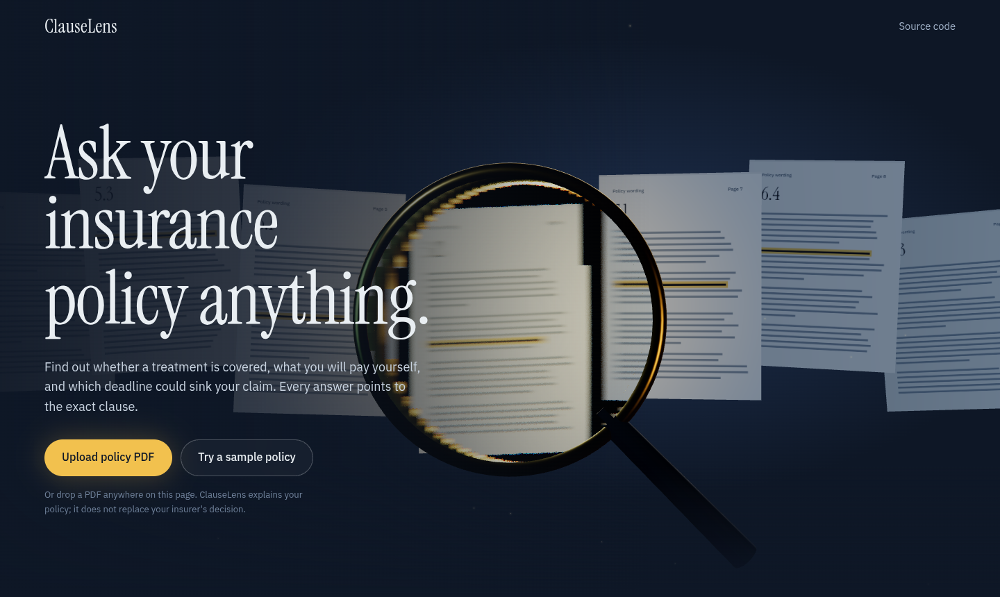
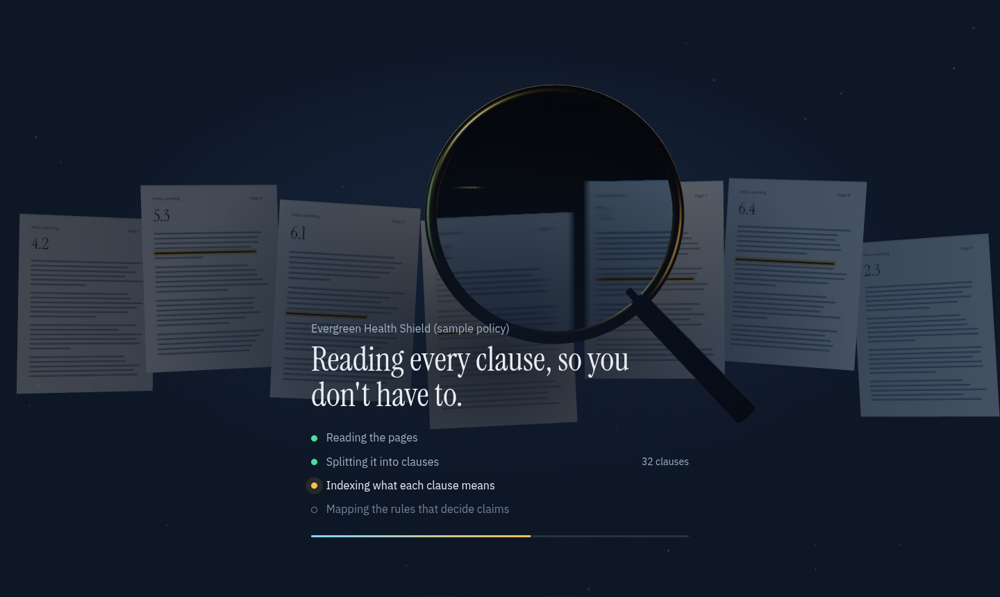
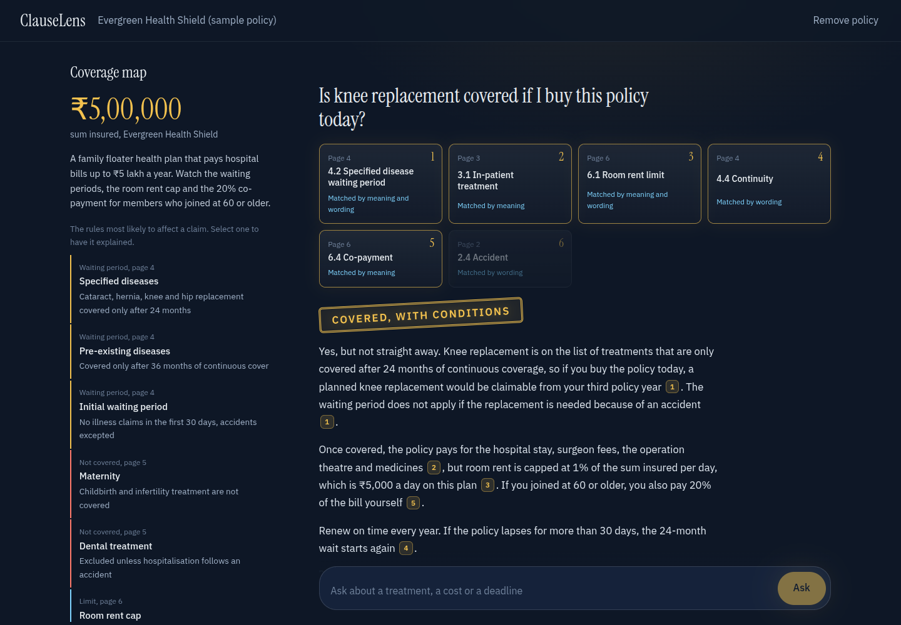
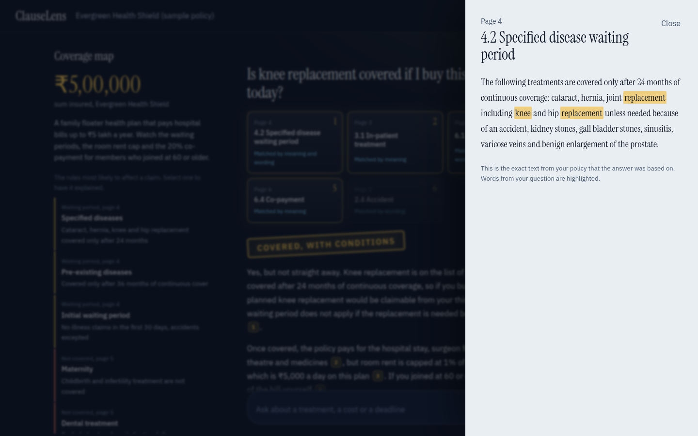
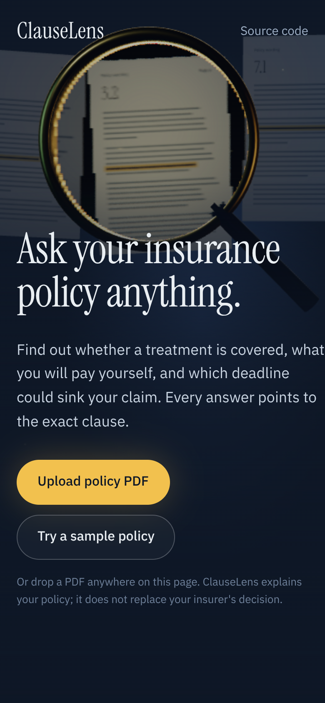

# ClauseLens

**Ask your insurance policy anything. Every answer cites the exact clause.**

Health insurance claims get rejected over clauses nobody read: a 24-month waiting period, a room rent cap that quietly shrinks the whole bill, a 24-hour deadline to inform the insurer. Policy wordings run to dozens of pages of legal text, so people find these rules after the claim is refused.

ClauseLens reads the policy for you. Upload the policy PDF, ask in your own words ("Is knee surgery covered if I buy this today?"), and get a verdict (covered, not covered, covered with conditions, or unclear), a plain-language explanation, and a citation on every sentence that opens the exact clause it came from.

Built with **MongoDB, Express, React, Node.js**, a retrieval-augmented generation (RAG) pipeline, and a **Three.js** front end.



| Reading the policy | Answer with verdict and sources |
|---|---|
|  |  |

| Source clause, with your words highlighted | Mobile |
|---|---|
|  |  |

---

## Highlights

**RAG pipeline**
- PDF parsing page by page with `pdfjs-dist`, rebuilding line breaks from text positions so clause headings survive.
- **Clause-aware chunking**: splits at numbered headings ("4.2 Specified disease waiting period") so a chunk never mixes two rules, and every chunk keeps its page number and heading for citations.
- **Hybrid retrieval**: semantic search over embeddings plus **BM25** keyword search, merged with **Reciprocal Rank Fusion**. Each source shows whether it was matched by meaning, wording or both.
- Optional **MongoDB Atlas Vector Search** (`$vectorSearch`), with an in-memory cosine fallback so it runs on a local MongoDB too.
- **Grounded answers**: the model may only use numbered excerpts, must cite them, and must open with a verdict line. A streaming parser pulls the verdict out of the token stream as it arrives, even when it's split across chunks.
- **Coverage map**: multi-query retrieval collects the clauses that most often cause rejections (waiting periods, exclusions, sub-limits, co-payment, claim deadlines) and the model turns them into structured JSON, which is validated and sanitised before saving.
- **Streaming over Server-Sent Events**: sources, verdict and answer tokens arrive as separate events.
- **Pluggable AI providers**: Gemini (free tier), OpenAI, or a fully **offline mode** (hashed embeddings plus extractive answers) so anyone can clone and run it without an API key.

**Cinematic front end**
- A Three.js scene (React Three Fiber + drei): a glass magnifying lens with real refraction and chromatic aberration sweeps over floating policy pages, lit by a warm lamp, with a dolly-in camera on load and pointer parallax.
- The same scene becomes the loading screen: the lens scans the pages while the policy is processed.
- Retrieved clauses fly in from depth as cards so you can watch the search happen; the verdict lands as a rubber stamp with a small jolt; the answer streams in with a caret.
- Adaptive quality: `PerformanceMonitor` drops the glass to a cheaper mode when the frame rate dips. Respects `prefers-reduced-motion`.

## Architecture

```
            ┌──────────── React + Three.js (Vite) ────────────┐
            │  Landing (3D)  →  Ingest (3D scan)  →  Workspace │
            └───────────────┬───────────────────▲─────────────┘
          upload / ask (POST)│                   │ SSE: sources, verdict, tokens
            ┌───────────────▼───────────────────┴─────────────┐
            │ Express API                                     │
            │  ingest:  PDF → pages → clause chunks → embed   │
            │           → coverage map (multi-query + JSON)   │
            │  ask:     hybrid retrieve (vectors + BM25, RRF) │
            │           → grounded prompt → stream + parse    │
            └──────┬───────────────────────────┬──────────────┘
                   │                           │
            MongoDB (documents,          AI provider
            chunks + vectors,            Gemini | OpenAI | local
            questions)
```

```
clauselens/
├── server/
│   ├── src/
│   │   ├── rag/        pdf.js, chunker.js, bm25.js, vector.js (cosine, RRF),
│   │   │               prompts.js, verdict.js (streaming verdict parser)
│   │   ├── ai/         gemini.js, openai.js, local.js (offline), sse.js
│   │   ├── services/   ingest.js (pipeline), retrieve.js (hybrid search + cache)
│   │   ├── routes/     documents.js (upload, sample, ask via SSE, ...)
│   │   ├── models/     Document, Chunk, Question
│   │   └── sample/     an original, fictional policy for the demo
│   └── test/           node:test suite, including a real PDF fixture
├── client/
│   └── src/
│       ├── three/      HeroScene.jsx (lens, pages, camera rig), pageTexture.js
│       ├── pages/      Landing, Workspace
│       └── components/ AnswerCard, VerdictStamp, SourceCards, SourceDrawer,
│                       CoverageMap, IngestStatus, AskBox
└── screenshots/
```

## How retrieval works

1. **Chunking.** Each page is scanned for clause headings (numbered like `4.2 …` or all-caps like `EXCLUSIONS`). Text under a heading is packed into chunks of about 420 characters, never crossing into the next clause; very long clauses are split with overlap.
2. **Indexing.** Each chunk (heading + text) is embedded. The embedding model's id is stored on the document, because vectors from different models can't be compared.
3. **Query.** The question is run through two retrievers:
   - *meaning*: cosine similarity between the question's embedding and every chunk (or Atlas `$vectorSearch`);
   - *wording*: Okapi BM25 over the chunks, which catches exact terms like "cataract" or "co-payment" that embeddings sometimes blur.
4. **Fusion.** Reciprocal Rank Fusion, `score = Σ weight / (60 + rank)`, merges the two lists without needing their scores to be on the same scale. In offline mode the hashed vectors are weak, so they get a lower weight and act as a tie-breaker.
5. **Answer.** The top 6 clauses are numbered and passed to the model with strict instructions: verdict first, cite every claim, use only the excerpts, say UNCLEAR when the policy doesn't settle it.

## Running it locally

You need Node.js 18+ and MongoDB (local, or a free Atlas cluster).

```bash
git clone https://github.com/<your-username>/clauselens.git
cd clauselens
npm install
npm run install:all

cp server/.env.example server/.env
# Works immediately with AI_PROVIDER=local (no key).
# For real AI answers, get a free Gemini key at https://aistudio.google.com/apikey
# then set AI_PROVIDER=gemini and GEMINI_API_KEY=... in server/.env

npm run dev     # API on :5000, web app on :5173
npm test        # RAG unit tests
```

Open http://localhost:5173 and choose **Try a sample policy**, or upload a text-based policy PDF (scanned image-only PDFs aren't supported yet).

If you switch AI provider after uploading, remove and re-add the policy so its embeddings are rebuilt with the new model. Until then, retrieval falls back to keyword search only.

### Optional: Atlas Vector Search

Create a vector search index named `chunk_vector` on the `chunks` collection:

```json
{
  "fields": [
    { "type": "vector", "path": "embedding", "numDimensions": 768, "similarity": "cosine" },
    { "type": "filter", "path": "doc" }
  ]
}
```

Use `numDimensions: 768` for Gemini, `1536` for OpenAI `text-embedding-3-small`, `512` for local. Then set `ATLAS_VECTOR_SEARCH=true`.

## API

| Method | Endpoint | Description |
|---|---|---|
| GET | `/api/health` | Status and active AI provider |
| GET | `/api/documents` | Policies in this workspace |
| POST | `/api/documents/upload` | Multipart PDF upload; processed in the background |
| POST | `/api/documents/sample` | Load the sample policy |
| GET | `/api/documents/:id` | Status, progress and coverage map |
| GET | `/api/documents/:id/chunks/:idx` | One clause |
| GET | `/api/documents/:id/questions` | Question history |
| POST | `/api/documents/:id/ask` | `{ question }`, responds with an SSE stream |
| DELETE | `/api/documents/:id` | Remove a policy and its data |

All document routes need an `x-workspace` header (the client generates and stores a random id).

## Deploying

- **Database:** MongoDB Atlas free tier.
- **API:** Render or Railway (Node service; SSE needs a long-lived connection, so avoid serverless functions with short timeouts). Set the variables from `server/.env.example`, with `CLIENT_URL` set to your frontend URL.
- **Client:** Vercel or Netlify, root `client/`, build `npm run build`, output `dist`, set `VITE_API_URL` to the API URL, and rewrite all paths to `/index.html`.

## Limitations and next steps

- OCR for scanned PDFs (e.g. Tesseract) before chunking.
- Cross-encoder re-ranking of the fused results.
- An evaluation set of question/clause pairs to measure retrieval recall@k as the pipeline changes.
- Compare two policies side by side before buying.
- Accounts, so policies follow you across devices.

ClauseLens explains policy text; it is not legal or financial advice, and the insurer's decision is final.

## License

MIT
